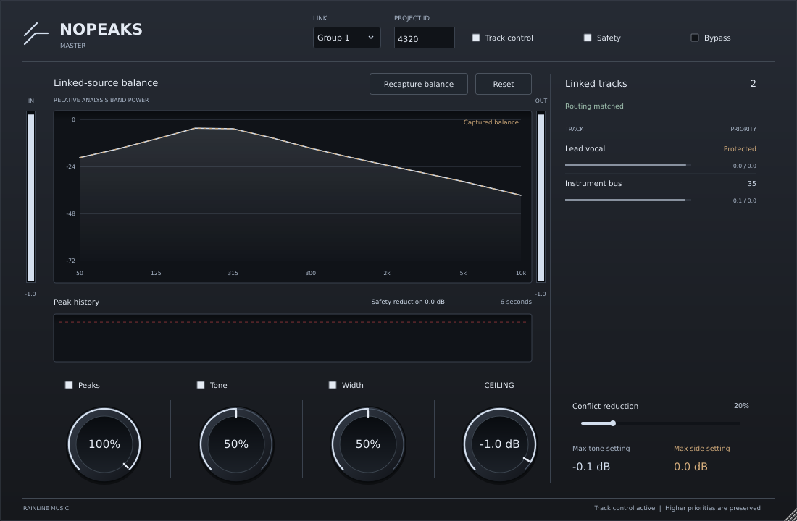

# NOPEAKS

**A cooperative VST3 pair for peak control, priority-aware spectral cuts and frequency-dependent stereo repair.**

NOPEAKS Master observes the mix; NOPEAKS Track supplies the individual sources and applies the distributed corrections. Both are native C++17 / JUCE 8 plug-ins. The interface follows the supplied Rainline Clipper reference.

**Version 0.1.0 is an engineering preview.** The repository includes functioning DSP, process-independent communication, synthetic audio validation and a native processor test host. Listening validation on real multitracks and testing in Ableton Live remain necessary before production release. No trained preference model, universal “ideal EQ”, automatic allpass rotation, or true-peak certification is claimed.

Native editor rendered from a synthetic linked-source test. [Track editor](docs/images/track.png).

## Build downloads

Open [GitHub Actions](https://github.com/RainlineMusic/nopeaks/actions), select a successful **Build and test NOPEAKS** run, and download its artifact:

| Artifact | Architecture | Contains |
| --- | --- | --- |
| `NOPEAKS-Windows-x64` | Windows x64 | Master + Track VST3 bundles |
| `NOPEAKS-macOS-universal` | Apple Silicon + Intel | Master + Track VST3 bundles |
| `NOPEAKS-Linux-x64` | Linux x86-64 | Master + Track VST3 bundles |

These are unsigned development builds. Build instructions and the pinned dependency revision are in [docs/BUILD.md](docs/BUILD.md).

## Set up a supported session

1. Insert **NOPEAKS Track last** on either all source groups **or** all contributing tracks. Each source must be represented once. Do not instrument both a group and its children.
2. Insert **NOPEAKS Master** after those sources sum. For the first version, bypass other processors between Track and Master and use unity post-insert faders. Move the desired level adjustment before Track instead. Include audible returns in the represented sources.
3. Set the same **Project ID** and **Link group** on the pair. Use a different Project ID for another simultaneously open project. Names are manual because VST3 does not reliably expose a DAW track name to all hosts.
4. Start playback. The Master compares its actual input with reconstructed delayed Track output. **Routing verified** requires repeated non-silent matches; stopped transport, missing sources, additional gain, double counting and mismatched timing do not authorize cooperation.
5. Enable **Track control** after arranging this topology. High **Priority** makes a source more expensive to change; **Protect track** excludes it from direct Track corrections. Master Safety still acts on the summed mix. Automation is supported for the effect parameters; change project routing and identifiers while stopped.
6. Leave **Safety** enabled while evaluating Peaks. It handles the part that the distributed plan cannot solve.

Read [the Russian quick start](docs/QUICKSTART_RU.md) before testing in Live.

## Three cooperating processes

### Peaks

Tracks publish full signed stereo frames with original timeline positions and hold audio for **8192 samples**. Master solves a bounded priority-weighted gain allocation against the coherent predicted sum and returns commands for those exact frames before delayed playback. This makes the operation causal and independent of the order in which source callbacks run.

Only attenuation is applied; protected sources remain at unity. Frame transitions are ramped. A stereo-linked **sample-peak** safety limiter on Master, with **256 samples** of fixed latency, catches infeasible constraints, cancellation changes, processing transitions and prediction errors. It can be disabled explicitly. This is not an inter-sample/true-peak limiter.

### Tone and conflicts

There is **no factory “ideal” spectral curve**. **Capture balance** measures two seconds of active linked-track band powers and stores their normalized spectral distribution. Subsequent broad excesses relative to that distribution are assigned preferentially to less important tracks. It is a cut-only controller: it cannot repair missing energy with a boost.

An independent **Conflicts** control enables a conservative overlap heuristic that cuts lower-priority sources sharing active bands with more important sources. It is a diagnostic mixing aid, not a validated model of listener preference. At zero Conflicts and without a captured target, Tone applies no correction.

Analysis powers use a 250 ms smoother; EQ parameters have separate attack/release smoothing. Twelve overlapping bell filters use identical coefficients on L/R. Both commanded and smoothed controls have an aggregate six dB tone budget. The abstract band-power allocation and the realized overlapping-filter response are different objects; the tests measure the actual transfer function.

### Width

Measured negative crosspower on Master gates side-only EQ on contributing sources, with priority and protection. Mid is preserved. An additive power-share model allocates the intervention; actual Master feedback is remeasured, with a slow release. Twelve overlapping side bells share a twelve dB control budget.

Coherent side cancellation cannot be inferred from band powers alone. Pure anti-phase material with zero Mid cannot achieve positive correlation through finite Side attenuation. The preview reduces destructive side energy; it does not promise to make every band mono-compatible. Check the audible result and residual correlation.

## Latency

| Path | Fixed latency | At 48 kHz |
| --- | ---: | ---: |
| Track | 8192 samples | 170.67 ms |
| Master | 256 samples | 5.33 ms |
| Track → Master | 8448 samples | 176.00 ms |

The host must compensate plugin delay. Both the UI Bypass and host bypass retain each plug-in's declared delay. This mode suits mixing, rather than live tracking. Cooperative control is disabled for host blocks larger than 4096 samples. A playing host sample clock is required; stopped playback retains delayed monitoring and disables cooperation.

## Verification and design documents

- [Scientific sources and patent landscape](docs/RESEARCH.md)
- [Equations, engineering assumptions and test requirements](docs/ALGORITHMS.md)
- [Architecture and failure behavior](docs/ARCHITECTURE.md)
- [Build, CI and packaging](docs/BUILD.md)
- [Interface design](docs/DESIGN.md)
- [Validation record](docs/VALIDATION.md)

Core tests cover DSP neutrality, delay, sample-peak ceilings, priorities, protection, signed cancellation, spectral transfer, M/S invariants, exact scheduling, independent timeline epochs, cross-process communication, concurrent snapshots, stale capabilities and project isolation. The native host test exercises the actual processor classes, bypass, live monitoring, target persistence, a downstream gain mismatch and allocation-free callbacks.

## Boundaries of the preview

- One Master per Project ID/group; up to 64 linked Tracks. A duplicate Master does not gain a controller lease.
- Routing validation is a necessary observation, not a proof of arbitrary DAW topology. Delayed, nonlinear, automated or unrepresented downstream processing can revoke it.
- No automatic adjustment of post-insert fader weights or upstream delay estimation is implemented. Follow the routing instructions.
- Host-specific PDC behavior, sandboxed plug-in hosting, state cloning and project reopen need real DAW testing.
- No automatic allpass is included: phase rotation can increase a coherent summed peak or damage multi-microphone relationships.
- Analysis bands and priority rules are engineering choices, not a claim that a paper established these as optimal musical numbers.
- Patent references describe prior art; this repository does not assert patent novelty or freedom to operate.

JUCE is obtained separately at a pinned revision. Distribution requires compliance with its applicable license. See [THIRD_PARTY.md](THIRD_PARTY.md).
